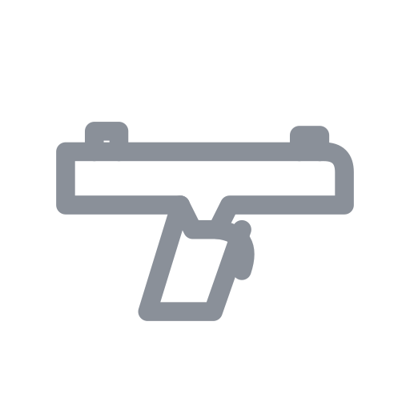

# HKugz Games

Free browser games, built by HKugz. Everything runs in your browser: no downloads, no sign-ups, no ads, no tracking.

| Game | Type |
|---|---|
| **Tower of Destiny** | The one-button classic by DrDerico (2016), shared here with the developer's permission. Climb the tower, open chests, dodge traps, stomp monsters, buy skins and upgrades. Has a fullscreen button (or press F). |
| **Blaster Arena** | Original 3D shooter vs bots (Three.js): 21 maps (5 new XL maps for every mode (the newest, Shadow Village XL, is a dusk village full of hiding places), 8 classic: Pastel Plaza, Neon Docks, Sunset Ruins, Frost Fort, Toy Box, Pirate Cove, Lava Lair, Orbit Station; Battle Room (Ender's Game: a zero-gravity cube with floating stars, flash suits, freezing guns and gate runs, first to 3 battles); Jungle Highlands and Jungle Highlands XL (8x bigger), a Vietnam-style jungle for Sniper's Alley with hundreds of trees you can climb into, bushes to sneak through, climbable needle spires, bamboo watchtowers and jump pads; plus 4 huge Battle Royale maps: Candy Canyon, Jungle Temple, Skyline City, Moonbase Alpha), 14 modes (including C4 Flash: sneak around in a ninja suit, stick C4 on bots and blow them all up at once; a Test Lab with a wall of buttons and a gentle Baby Mode for little kids), controller support (Team Deathmatch, Horde, Blitz, Brawl, Battle Royale, Freeplay practice range, Gun Game with a ladder of 10 blasters, low-gravity Moon Brawl, Pop-Gun Party, and Sniper's Alley: snipers only, six sniper rifles (Scout, Zapper, Marksman, Hunter, Railgun, Viper) and five scopes (Red Dot, 4x, 8x, 12x, Thermal) found in chests and on the ground, bot teammates and bot snipers; you can climb rocks, walls, spires and trees, and treetops hide you from bots), 12 blasters (including a rare RPG), 7 kinds of grenades plus C4 with a remote with rarities and ammo, a 5-slot hotbar, chests, solo or online co-op for up to 4 players. Runs on Chromebooks (auto Low-graphics mode, trackpad-friendly aim toggle; touch controls for phones and tablets: floating joystick, look pad, fire/aim/jump buttons, tappable hotbar) |
| **Core Strike** | Original 5v5 tactical shooter (Three.js, Krunker-style look, no blood): Competitive rounds (buy menu and economy, plant or defuse the core, switch sides at halftime), Deathmatch and an Aim Range; online play for up to 6 players (room codes through PeerJS, friends fill the teams with the bots); 3 maps (Sandstone, Warehouse, Courtyard); 15 guns plus a karambit, HE, flash, smoke and molotov grenades; bots that call out enemies, trade kills, flash and push, smoke the core, avoid fire and save guns. Mouse and keyboard on a computer |
| **Fort Fight** | Original building shooter (Three.js), first person with a third-person option: walls, floors, stairs and roofs on a grid with materials and HP, editing (cut doors, windows and holes), a build range with a sky-ring ramp challenge, box fights (first to 5 rounds), a 6-player island free-for-all against bots, and online play for up to 4 players (box fights or building together, room codes through PeerJS). Auto Low-graphics mode for Chromebooks; touch controls for phones and tablets (joystick, look pad, build and edit buttons) |
| **Sky Tower** | Original 3D obby tower climber (Three.js): a generated tower of 10 themed stages (moving platforms and lifts, crumbling tiles, ice, bounce pads, conveyor belts, spinning bars, hammers, pistons, zap strips) with checkpoints, best times, a seeded Random Tower and a no-checkpoint Hardcore mode. Auto Low-graphics mode for Chromebooks; touch controls for phones and tablets |
| **Kart Rush** | Original toon kart racer (Three.js): 3 tracks (Sunny Loop, Neon City, Frosty Peaks with ice patches), 8 karts with 3 kart types, drifting with 3 mini-turbo tiers, boost pads, rocket start, item boxes (turbo, rockets, oil slicks, shield, zap, with rubber-banded item odds), Grand Prix points over all three tracks, single races, time trial with saved best laps, 3 robot difficulties. Auto Low-graphics mode for Chromebooks; touch controls for phones and tablets (steer stick, drift, item, brake, automatic gas) |
| **Gadget Guard** | Original toon tower defense (Three.js): 3 maps (Meadow Run, Twin Gates with two portals, Frozen Spiral), 6 gadgets with 4 upgrade levels each (Pop Blaster, Boomer, Frost Zapper, Rail Sniper, Tesla Coil, Booster), 7 robot types (armored Tanks, flying Copters, healing Medics, MEGA BOT bosses at waves 10, 20 and 30), 30-wave mode and Endless mode, 3 difficulties with star ratings, targeting modes, airstrike ability, 1x/2x/3x speed and auto-start. Tap-friendly controls for phones and tablets (drag to pan, pinch to zoom); auto Low-graphics mode for Chromebooks |
| **Wobble Dash** | Original obstacle-race game (Three.js): wobbly beans run, jump (hold for height), sprint and dive through 3 courses (Candy Run, Factory Frenzy, Cloud Rush) full of spinning bars, swinging hammers, sliding gates, side pushers, conveyor belts, ferries, trampolines, narrow beams and crumbling tiles. Showdown mode: 12 racers, then 8, then the final 4 for the crown; Quick Race on any course; 3 bot difficulties; best times saved. Bots follow waypoints, hop gaps, ride ferries and balance on beams. Camera drifts behind you automatically; touch controls for phones and tablets; auto Low-graphics mode for Chromebooks |
| **Putt Party** | Original 3D mini golf (Three.js): 9 holes in 3 themes (meadow, desert, neon) with bumpers, a windmill, sand, a water pond, boost strips, sliding walls, teleport pipes and a final Gauntlet. Slingshot aiming with mouse or finger (or keyboard: arrows + hold Space), a dotted bounce preview, 1-3 computer golfers (Easy/Normal/Hard) that try shots in the physics simulation and play at the same time as you, scorecards, results and best scores. The camera frames your ball and the cup and turns sideways for long holes. Auto Low-graphics mode for Chromebooks |
| **Block Stack** | Original one-button game |
| **Cube Flap** | Original one-button game |
| **Snake** | Classic |
| **Breakout** | Classic |
| Scratch game | Coming soon |

Scores and progress are saved only in your own browser (`localStorage`).

## Play timer (for parents)

An opt-in daily play-time limit for one device. A parent opens `timer/` on the kids' phone, tablet or computer, picks a PIN and a daily limit, and turns it on. The games then show how much time is left, warn at 5 minutes and 1 minute, and send every page to a "time's up" screen when the limit is reached; a parent can add time with the PIN. Nothing is on by default, so nobody else is affected, and nothing is sent anywhere: the timer and the scrambled PIN live in that browser's `localStorage` (key `hktimer`, never included in save codes). It is a nudge, not a lock (clearing site data or using another browser gets around it); Google Family Link, Screen Time or Microsoft Family Safety are the stronger option. Every page loads `assets/playtimer.js` in its `<head>`: add the same tag to any new game page.

## Running locally

It is a plain static site. Serve the folder with any static file server, for example `npx serve` or `python -m http.server`, and open `index.html`.

## Third-party code

Blaster Arena, Core Strike, Fort Fight, Sky Tower, Kart Rush, Gadget Guard, Wobble Dash and Putt Party bundle [Three.js](https://threejs.org/) r160 (MIT license, see `games/blaster-arena/THREE-LICENSE.txt`, `games/core-strike/THREE-LICENSE.txt` and `games/fort-fight/THREE-LICENSE.txt`) and [PeerJS](https://peerjs.com/) 1.5.4 (MIT license, see `games/blaster-arena/vendor/PEERJS-LICENSE.txt`, `games/core-strike/vendor/PEERJS-LICENSE.txt` and `games/fort-fight/vendor/PEERJS-LICENSE.txt`).

### Blaster Arena online co-op

One player hosts and gets a 5-letter room code; up to 3 friends join with it. Players connect directly (WebRTC). The free PeerJS Cloud service is only used to introduce them to each other, so players can see each other's network address; only share your room code with people you know. The host runs the bots; there is no chat, only player names. For offline testing, open two tabs with `?net=local`.

### Core Strike online play

The host gets a 5-letter room code and up to 5 friends join with it (6 players in total, split across the two teams of 5; the bots fill the empty spots). Players connect directly (WebRTC) and PeerJS Cloud is only used to introduce them, so players can see each other's network address; only share your room code with people you know. The host runs the match (bots, rounds, money, the core, grenades and damage) and each player moves and aims on their own computer. Competitive and Deathmatch both work online; if a friend leaves, a bot takes their place. For offline testing, open two tabs with `?net=local`.

### Fort Fight online play

Same idea as Blaster Arena: the host gets a 5-letter room code and up to 3 friends join with it, connected directly (WebRTC) with PeerJS Cloud only used to introduce the players. The host runs the rules (rounds, wall health); every player simulates themselves and applies their own damage. Box fights are 1v1 (first to 5 rounds) or a 3-4 player free-for-all (first to 3 round wins); the Build Range can also be shared.
